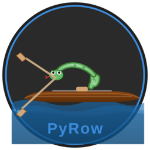

# PyRow

[](https://github.com/jorgemira/pyrow/actions/workflows/ci.yml)
[](LICENSE)
[](https://www.python.org/)

A visual rowing workout pacer. PyRow shows an animated rowing figure that paces your stroke in an
always-on-top window, so you can keep it beside the erg monitor and just follow the figure.



## Contents

- [What it does](#what-it-does)
- [Requirements](#requirements)
- [Installation](#installation)
- [Usage](#usage)
- [Controls](#controls)
- [Drills](#drills)
- [The workout library](#the-workout-library)
- [Workout file format](#workout-file-format)
- [How it works](#how-it-works)
- [Development](#development)
- [Project layout](#project-layout)
- [Troubleshooting](#troubleshooting)
- [License](#license)

## What it does

- **Paces your stroke.** An animated figure rows at the target rate. Body parts that should not be
  moving are dimmed, so it is obvious at a glance what the drill is asking for.
- **Runs a whole session.** Warmup, work, rest and cooldown sections play in order, with drills
  cycling per stroke and a beep five seconds before every change so you are never surprised.
- **Ships 116 workouts** across three levels, filterable by level and duration, plus an editor for
  building your own.
- **Keeps the stroke honest.** Each section's cycle time is adjusted so sections always begin and
  end at the catch, and offsets are cosine-blended on transition strokes rather than snapping.
- **Stays out of the way.** The window pins itself to the top-right of the primary monitor, is
  resizable (everything scales proportionally), and explicitly allows the screen to sleep.

## Requirements

- **Python 3.14+**
- **[uv](https://docs.astral.sh/uv/)** for dependency management
- A desktop session — the pacer is a GUI app. Audio is optional; without a sound device PyRow
  still runs and simply stays silent.

On Linux you may also need Tk and the SDL runtime libraries, which are not Python packages:

```bash
# Debian / Ubuntu / Mint
sudo apt install python3-tk libsdl2-dev libsdl2-mixer-dev libsdl2-image-dev libsdl2-ttf-dev

# Fedora
sudo dnf install python3-tkinter SDL2-devel SDL2_mixer-devel SDL2_image-devel SDL2_ttf-devel
```

## Installation

```bash
git clone https://github.com/jorgemira/pyrow.git
cd pyrow
uv sync
```

`uv sync` creates the virtualenv and installs both runtime dependencies (`pygame-ce`,
`customtkinter`) and the dev tools (`ruff`, `ty`, `prek`, `sphinx`). There is no separate
`pip install` step, and no need to activate the venv by hand — `uv run` handles it.

## Usage

```bash
uv run python main.py
```

Pick a workout from the list, press **Play** (or double-click it), then **Space** or **Enter** to
start. The workout opens paused on a "Ready?" screen so you can get your hands on the handle first.

The project is not installed as a package, so run it via `main.py` as above rather than a `pyrow`
command.

## Controls

**Menu**

| Key | Action |
|---|---|
| `↑` `↓` | Move through the workout list |
| `Home` `End` | Jump to first / last workout |
| `Enter` | Play the selected workout |
| `Esc` | Quit |
| Double-click | Select and play a workout |
| Hover | Show the workout's description after ~1s |

**Ready screen**

| Key | Action |
|---|---|
| `Space` / `Enter` | Start the workout |
| `Esc` | Back to the menu |
| `M` | Mute the beeps |

**During a workout**

| Key | Action |
|---|---|
| `Space` | Pause / resume |
| `←` `→` | Previous / next section |
| `M` | Mute the beeps |
| `Esc` | Stop (asks to confirm — `Y`/`Enter` confirms, `N`/`Esc` dismisses) |

Both progress bars — section and total — can be clicked and dragged to scrub, with a tooltip
showing the target time. The side panel lists the remaining sections under "Up next" and scrolls
with the mouse wheel.

## Drills

Every drill maps position `0.0` to the catch (legs compressed, body forward, arms extended), so
drills stay in sync when they cycle mid-section. A section holding several drills rotates through
them one per stroke.

| Drill | Highlighted | Behaviour |
|---|---|---|
| Full Stroke | arms, body, legs | The complete stroke |
| Arms Only | arms | Body and legs dimmed, movement restricted to the arm draw |
| Arms And Hips | arms, body | Legs dimmed |
| Hips And Legs | body, legs | Arms dimmed |
| Legs Only | legs | Arms and body dimmed |
| Mid Slide | arms, body, legs | Restricted slide range, holding at mid-slide |
| Pause At Back | arms, body, legs | Holds at the finish (backstops) |
| Pause At Front | arms, body, legs | Holds at the catch (frontstops) |
| Pause Arms Away | arms, body, legs | Holds on the recovery with the arms extended |
| Pause Body Over | arms, body, legs | Holds on the recovery with the body pivoted over |

Pause drills hold for 22% of the stroke cycle at the pause point. Only the four part-isolation
drills dim anything; the pause drills animate the whole figure. Rest sections animate a full stroke
at 16 spm in light blue.

## The workout library

`workouts.json` sits next to the code, so the library travels with the checkout and is easy to
back up or hand-edit. It currently holds **116 workouts** — 18 beginner, 49 intermediate and 49
advanced — each with a description shown as a tooltip on hover.

Filter the list by **level** (Beginner / Intermediate / Advanced) and by **duration**
(`< 20min`, `20-30min`, `30-45min`, `> 45min`).

Workouts are named `Level - Name - Extra`, e.g. `Intermediate - Pete Plan - Speed`, and the file is
kept sorted by level and then duration.

Use the built-in editor to add or change workouts. Saves are written atomically via a temporary
file, so an interrupted write cannot truncate your library.

## Workout file format

`workouts.json` is a plain JSON array. Fields at their default value are omitted when saving, so
older files stay loadable.

```json
[
  {
    "name": "Beginner - British Rowing Go Row - Week 1",
    "description": "Very short 1-minute intervals with equal rest.",
    "level": "beginner",
    "sections": [
      { "duration": 120, "stroke_rate": 16, "tension": 2, "drills": [], "repeats": 1,
        "section_type": "warmup" },
      { "duration": 60, "stroke_rate": 18, "tension": 3, "drills": [], "repeats": 5,
        "rest_after": 60 },
      { "duration": 180, "stroke_rate": 16, "tension": 2, "drills": [], "repeats": 1,
        "section_type": "cooldown" }
    ]
  }
]
```

**Workout**

| Field | Type | Default | Notes |
|---|---|---|---|
| `name` | string | required | `Level - Name - Extra` by convention |
| `sections` | array | `[]` | Played in order |
| `description` | string | `""` | Shown as a tooltip in the menu |
| `level` | `beginner` \| `intermediate` \| `advanced` | `beginner` | Drives the level filter |

**Section**

| Field | Type | Default | Notes |
|---|---|---|---|
| `duration` | int (seconds) | required | |
| `stroke_rate` | int (spm) | required | |
| `tension` | int 1–8 | `3` | Machine resistance |
| `drills` | array of `{type, count}` | `[]` | Empty means a full stroke |
| `repeats` | int | `1` | |
| `section_type` | `work` \| `rest` \| `warmup` \| `cooldown` | `work` | Affects colour and labelling |
| `rest_after` | int (seconds) | `0` | See below |

`rest_after` inserts rest *between* repeats for a multi-repeat section (not after the last one),
and *after* the section when `repeats` is 1. Generated rest sections run at 16 spm and inherit the
parent section's tension.

`drills[].type` is one of `none`, `arms_only`, `arms_and_hips`, `hips_and_legs`, `legs_only`,
`mid_slide`, `pause_at_back`, `pause_at_front`, `pause_arms_away`, `pause_body_over`, and `count`
is how many consecutive strokes it gets before rotating to the next drill.

If the file is malformed, PyRow fails with a message naming the offending entry rather than loading
a partial library.

## How it works

A small scene system runs the show: `SceneManager` owns the event loop and delegates to the active
`Scene`. The menu is customtkinter; the pacer itself is pygame.

For playback, `Workout.flatten_sections()` expands repeats and injects rest sections into a flat
list, and `WorkoutPlayer` steps through it as a state machine, pre-computing an adjusted cycle time
per section so every section starts and ends on a whole stroke.

See [`CLAUDE.md`](CLAUDE.md) for the full architecture notes, or build the Sphinx docs:

```bash
cd docs && uv run sphinx-build . _build
```

## Development

```bash
uv run pytest                 # tests
uv run ruff check --fix .     # lint
uv run ruff format .          # format
uv run ty check               # types
uv run prek run --all-files   # everything the pre-commit hook runs
```

Install the git hook so the same checks run on every commit:

```bash
uv run prek install
```

**Testing notes.** The pygame tests run headless on SDL's dummy video and audio drivers, so they
need no display or sound card. The customtkinter tests do map real Tk windows — tkinter has no
headless mode — and are placed off-screen; they skip automatically when there is no display, so in
a headless environment run them under `xvfb-run`:

```bash
xvfb-run -a uv run pytest
```

CI runs lint, format, type check, the full suite under `xvfb-run`, and a `pip-audit` dependency
audit on every push and pull request.

## Project layout

```
main.py              entry point — initialises pygame, launches the menu
models/workout.py    Workout, Section, DrillEntry and the enums
workout_player.py    playback state machine
workout_store.py     JSON persistence (atomic writes)
scenes/              scene system: manager, menu (tk), animation (pygame)
animations/          drill profiles, stroke maths, the figure itself
ui/                  workout editor and themed modal dialogs
tests/               pytest suite; conftest.py holds the GUI fixtures
workouts.json        the workout library
docs/                Sphinx documentation
```

## Troubleshooting

**"pygame module(s) failed to initialise; sound may be unavailable"** — usually the mixer on a
machine with no audio device. Harmless: the pacer works, silently.

**`ModuleNotFoundError: No module named 'tkinter'`** — Tk is not bundled with some Python builds.
Install it from your package manager (see [Requirements](#requirements)); `uv sync` cannot fix this,
as tkinter ships with Python rather than from PyPI.

**Tests skip with "no display"** — expected over SSH or on a headless box. Use
`xvfb-run -a uv run pytest` to actually run them.

**The window opens on the wrong screen** — PyRow centres the window and inverts the arithmetic to
find the monitor origin, because SDL does not report it. On unusual multi-monitor layouts it may
land on the wrong screen; just drag it, as the position is not persisted.

## License

[MIT](LICENSE) — © 2026 JorgeMira
